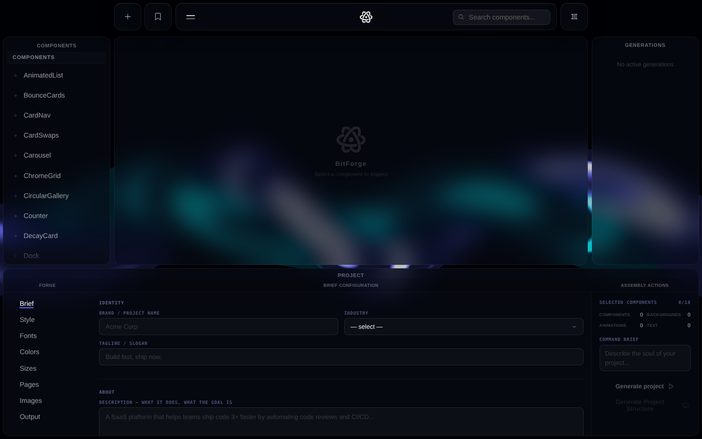

# BitForge

A desktop app (Electron + React + TypeScript) for browsing the [React Bits](https://reactbits.dev) component library and turning a short project brief into a complete, ready-to-run Vite + React website with the help of Claude.



## What it does

- **Browse 100+ animated components** (backgrounds, text animations, UI components and animations) with search, a live preview, the source code and the install command for each one.
- **Write a project brief**: brand name, industry, tone, fonts, colours, sizes, pages, images and output options, plus the components you want to use (up to 10).
- **Enhance the prompt**: the raw brief is sent to Claude (Haiku 4.5 for the draft, Sonnet 4.6 for refinement) and comes back as a structured JSON design brief.
- **Generate the site**: the app scaffolds a Vite + React project on disk, then an AI composer (Claude Code, run as a child process) writes the layout, copy and styling around the chosen components.
- **Quality gates and repair loop**: the generated project is checked and, if something fails, an AI reviewer runs repair passes. If the composer fails, a deterministic builder produces a fallback site.
- **Live task queue**: generations run in the background with live logs streamed to the UI over IPC; a watchdog process keeps long generations alive.
- **Presets and history**: briefs can be saved as named presets, and every original and enhanced prompt is stored locally.

## Tech stack

| Layer | Technology |
|---|---|
| UI | React 18, TypeScript, Vite, Framer Motion, GSAP |
| 3D / WebGL | Three.js, OGL, @react-three/fiber |
| Desktop | Electron 40, typed preload bridge (`window.reactBitsApi`), Electron Builder |
| AI | Anthropic SDK (prompt enhancer), Claude Code CLI (composer and reviewer) |
| Tooling | ESLint, TypeScript type checks (`npm run check`) |

## How it works

```
Component browsing
  reactbits-manifest.json → useComponentLoader → component list → inspector (preview / code / install)

Project generation
  Project brief panel
    → promptEnhancer (Anthropic SDK) → structured JSON brief
    → Generate wizard (name, folder, package manager)
    → DemoCLI: scaffold Vite + React project
    → aiComposer (Claude Code) writes pages, layout and copy
    → quality gates → aiReviewer repair loop → fallback builder if needed
    → files written to disk, progress streamed back to the task queue
```

## Project structure

```
src/
  features/        browser, inspector, project-builder, preset-manager, generation
  showcase/        React Bits components used by the app's own UI
  shared/          types, hooks, utilities, shared components
  styles/          design tokens and global layout CSS
electron/          main process, preload bridge, AI enhancer / composer / reviewer, storage, watchdog
DemoCLI/           project generators (scaffolder, page and app builders, component mapping)
ReactBitsComponents/  the component sources the app browses (see license below)
scripts/           manifest generator
```

## Running it locally

Requirements: Node.js 20+, an Anthropic API key, Windows (the scripts and the packaged build target Windows).

```bash
npm install
```

Create a `.env` file in the project root:

```
ANTHROPIC_API_KEY=your-key-here
```

Then start the app (in PowerShell, allow scripts for the session first):

```powershell
Set-ExecutionPolicy -ExecutionPolicy Bypass -Scope Process; npm run dev
```

`npm run dev` regenerates the component manifest, starts Vite and opens the Electron window. `npm run build:electron` builds a portable Windows executable.

## Credits and license

The components in `ReactBitsComponents/` come from [React Bits](https://github.com/DavidHDev/react-bits) by David Haz and are used under the MIT + Commons Clause license included in [`ReactBitsComponents/LICENSE-ReactBits.md`](ReactBitsComponents/LICENSE-ReactBits.md). BitForge is an independent project and is not affiliated with React Bits.

The rest of the code (the Electron app, the generation pipeline and the UI) is by [Panos Spanos](https://github.com/Spanos-Panos).
